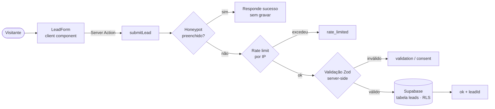

<div align="center">

# Biel Strategy

**Site de aquisição e posicionamento profissional de Gabriel Serra — Estrategista de Aquisição & Soluções Digitais.**

Next.js 16 · React 19 · TypeScript · Supabase · GSAP

[](https://bielstrategy.com)


</div>

---

## Visão geral

Site em produção em **[bielstrategy.com](https://bielstrategy.com)** que combina duas funções: apresentar a trajetória, os cases e a stack do profissional (Marketing como eixo principal, Tecnologia como segundo eixo e IA como camada complementar) e **capturar leads qualificados** por meio de um formulário nativo de pré-diagnóstico, gravado direto em banco.

O projeto nasceu de um protótipo visual aprovado no Claude Design e foi implementado fielmente em Next.js, com o conteúdo derivado de uma pesquisa documentada (`RESEARCH.md`) — nenhum dado do site foi inventado além do que está auditado ali.

## Problema que resolve

Sites pessoais costumam ser só um cartão de visita: não medem de onde vem o visitante nem qualificam o contato. Aqui o site também funciona como **ponto de entrada comercial**: o formulário em etapas reduz atrito, registra a origem do tráfego (UTM e click IDs) e guarda o consentimento LGPD de cada lead.

## Principais funcionalidades

| Área | O que existe no código |
|---|---|
| **Formulário de pré-diagnóstico** | 8 etapas (negócio, desafio, situação atual, histórico, objetivo, momento, investimento, contato) — `src/components/sections/lead-form/` |
| **Persistência de leads** | Server Action grava no Supabase (Postgres) — `src/app/actions/submitLead.ts` |
| **Validação server-side** | Schema Zod autoritativo; campos de qualificação opcionais (baixa fricção), contato e consentimento obrigatórios — `src/lib/leads/schema.ts` |
| **Anti-spam** | Campo *honeypot* + rate limit por IP em memória (5 req/min) — `src/lib/leads/rateLimit.ts` |
| **Atribuição de campanha** | Captura `utm_*`, `gclid`, `gbraid`, `wbraid`, `fbclid`, página de entrada e referrer — `src/hooks/useLeadTracking.ts` |
| **LGPD** | Consentimento versionado com timestamp por lead; página de política de privacidade |
| **Segurança de dados** | RLS no Supabase: a chave `anon` só tem `INSERT` (sem `SELECT`), com *policy* restritiva — `supabase/migrations/` |
| **Selo de segurança do site** | Consulta real à API Google Safe Browsing v4 (opcional, com cache de 15 min) — `src/app/actions/checkSafeBrowsing.ts` |
| **Segurança HTTP** | HSTS, `X-Content-Type-Options`, `X-Frame-Options`, `Referrer-Policy`, `Permissions-Policy` — `next.config.mjs` |
| **SEO técnico** | Metadata, Open Graph, `sitemap.ts`, `robots.ts`, dados estruturados (JSON-LD) |
| **Experiência visual** | Animações GSAP + ScrollTrigger com fallback completo para `prefers-reduced-motion` |

## Stack

| Camada | Tecnologia |
|---|---|
| Framework | Next.js 16 (App Router, Server Actions) + React 19 |
| Linguagem | TypeScript (`strict`) |
| Estilo | CSS vanilla orientado a *design tokens* (cores, tipografia, espaçamento, motion, elevação, raio) |
| Animação | GSAP 3 + ScrollTrigger |
| Banco de dados | Supabase (PostgreSQL com Row Level Security) via `@supabase/supabase-js` |
| Validação | Zod 4 |
| Fontes e imagens | `next/font` (Montserrat + Inter, self-hosted) e `next/image` |

## Arquitetura



Decisão de projeto relevante: o `id` do lead é gerado no servidor (`randomUUID`) em vez de usar `INSERT ... RETURNING`, porque a chave `anon` **não possui policy de `SELECT` de propósito** — mesmo que a chave vaze, ninguém lê os leads de volta.

### Estrutura de diretórios

```text
src/
├── app/
│   ├── actions/            # Server Actions (submitLead, checkSafeBrowsing)
│   ├── politica-de-privacidade/
│   ├── layout.tsx          # metadata, SEO, JSON-LD
│   ├── robots.ts · sitemap.ts
│   └── globals.css
├── components/
│   ├── sections/           # Hero, Jornada, Marketing, Casos, Tecnologia, IA, Formação, Fechamento…
│   │   └── lead-form/      # formulário em etapas
│   └── ui/                 # primitivas do design system (Button, Section, Reveal, Quote…)
├── data/                   # conteúdo tipado (site.ts) e definição do formulário (leadForm.ts)
├── hooks/                  # useLeadTracking, useMagnetic
├── lib/
│   ├── leads/              # schema (Zod), rateLimit, score
│   ├── supabase/server.ts  # cliente Supabase server-only
│   └── gsap.ts             # registro único do GSAP + guarda de reduced-motion
└── styles/tokens/          # tokens do design system
supabase/migrations/        # schema versionado + endurecimento de RLS
public/                     # marca, imagens e mídia dos cases
```

## Requisitos

- Node.js 20.9 ou superior (requisito do Next.js 16)
- npm
- Um projeto Supabase (para o formulário gravar leads)

## Como executar localmente

```bash
git clone https://github.com/Gabriel-serra-eng/biel-strategy.git
cd biel-strategy
npm install
cp .env.example .env.local   # preencha os valores
npm run dev
```

Acesse [http://localhost:3000](http://localhost:3000).

Para criar a tabela de leads, aplique em ordem os arquivos de `supabase/migrations/` no seu projeto Supabase (SQL editor ou Supabase CLI).

### Variáveis de ambiente

Todas são lidas apenas no servidor — **nenhuma** usa o prefixo `NEXT_PUBLIC_`.

| Variável | Obrigatória | Descrição |
|---|---|---|
| `SUPABASE_URL` | Sim | URL do projeto Supabase |
| `SUPABASE_ANON_KEY` | Sim | Chave `anon` (só consegue `INSERT` em `leads`, por RLS) |
| `SAFE_BROWSING_API_KEY` | Não | Habilita o selo Google Safe Browsing; sem ela, o selo exibe "Verificação indisponível" e nada quebra |

### Scripts

| Comando | Função |
|---|---|
| `npm run dev` | Servidor de desenvolvimento |
| `npm run build` | Build de produção (`next build --webpack`) |
| `npm run start` | Serve o build de produção |
| `npm run lint` | ESLint |

## Testes e validações

- ESLint e checagem de tipos (`tsc --noEmit`) executam sem erros.
- A validação de entrada é feita pelo schema Zod no servidor.
- **Ainda não há testes automatizados** (unitários ou E2E) nem pipeline de CI — veja *Próximas melhorias*.

## Limitações conhecidas

- O rate limit é em memória: funciona bem em um único processo Node (`next start`), mas em ambientes serverless com várias instâncias o limite passa a ser por instância. A evolução recomendada (contador compartilhado, como Redis) já está registrada em `LEAD_SYSTEM_RESEARCH.md`.
- O cálculo de *lead score* está **intencionalmente desativado** (`score_version = unscored-v0`) até a metodologia ser validada; o schema já está pronto para ativá-lo sem nova migration.
- A Content-Security-Policy ficou de fora por enquanto, para não quebrar a hidratação do Next.js e os scripts JSON-LD.

## Próximas melhorias

Itens já registrados na documentação do projeto:

- [ ] Rate limit distribuído (ex.: Upstash Redis)
- [ ] Ativar o lead score após validação da metodologia
- [ ] Content-Security-Policy

## Documentação do projeto

| Documento | Conteúdo |
|---|---|
| [`RESEARCH.md`](./RESEARCH.md) | Fonte de verdade do conteúdo: trajetória, competências, cases, stack |
| [`IMPLEMENTATION.md`](./IMPLEMENTATION.md) | Contrato técnico: arquitetura, performance, acessibilidade, SEO |
| [`LEAD_SYSTEM_RESEARCH.md`](./LEAD_SYSTEM_RESEARCH.md) | Pesquisa de arquitetura do sistema de leads e tracking |
| [`LEAD_FORM_IMPLEMENTATION.md`](./LEAD_FORM_IMPLEMENTATION.md) | Implementação do formulário nativo + Supabase |
| [`SITE_PROJECT_CONTEXT.md`](./SITE_PROJECT_CONTEXT.md) | Contexto consolidado do projeto |

## Processo de desenvolvimento com IA

O projeto foi construído com um fluxo de desenvolvimento assistido por IA, em etapas que deixaram artefatos neste repositório. **A aplicação não chama modelos de IA em tempo de execução**: a IA está no processo de construção, não no produto.

| Etapa | Ferramenta | Artefato |
|---|---|---|
| 1. Pesquisa e fonte de verdade do conteúdo | Pesquisa própria, organizada com apoio de IA | [`RESEARCH.md`](./RESEARCH.md) |
| 2. Protótipo visual | Claude Design | Design tokens em `src/styles/tokens/` |
| 3. Contrato técnico para o agente (fidelidade ao design, segurança, SEO, acessibilidade) | Escrito antes do código | [`IMPLEMENTATION.md`](./IMPLEMENTATION.md), `CLAUDE.md` |
| 4. Implementação e evolução | Claude Code | Histórico de commits, com co-autoria registrada |
| 5. Pesquisa de arquitetura do sistema de leads | Agente de pesquisa, com fontes citadas e pontos não confirmados sinalizados | [`LEAD_SYSTEM_RESEARCH.md`](./LEAD_SYSTEM_RESEARCH.md) |
| 6. Auditoria do código implementado | Antigravity | [`SITE_PROJECT_CONTEXT_ANTIGRAVITY.md`](./SITE_PROJECT_CONTEXT_ANTIGRAVITY.md) |

### Responsabilidades

- **Minhas:** definição do problema e do público, conteúdo e cases reais, aprovação do design, escolha do Supabase a partir da pesquisa comparativa, decisão de manter o lead score desligado até validar a metodologia, decisão de esconder seções sem evidência pública (Lead Radar), deploy e operação do site em produção.
- **Com assistência de IA:** escrita do código (Claude Code), pesquisa técnica comparativa, auditoria do estado do projeto, correções de build e de segurança (RLS).
- **Gerado por ferramentas:** o protótipo visual de origem (Claude Design) e o bloco de regras em `AGENTS.md`, criado automaticamente pelo `next dev`.

## Autor

**Gabriel Serra** — [GitHub](https://github.com/Gabriel-serra-eng)
