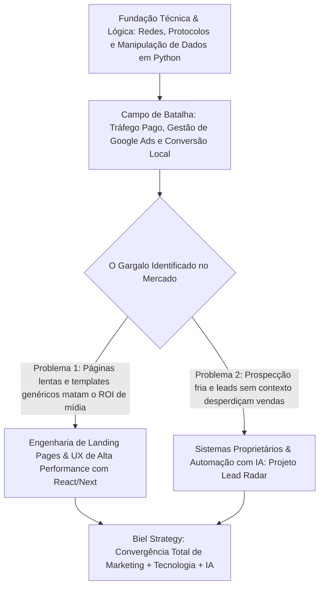

# BIEL_STRATEGY — MASTER RESEARCH (V2 REFINADA)
> **Documento Central de Verdade Estratégica e Técnica**  
> **Foco Narrativo:** **MARKETING** (Eixo Principal) → **TECNOLOGIA** (Segundo Eixo / Diferencial) → **IA** (Camada Complementar / Acelerador) → **BASE TÉCNICA** (Fundação)  
> **Status:** Refinado e Validado  
> **Próxima Etapa:** Claude Design (Design Spec & Wireframes)

---

## 01. Professional Identity & Core Value

| Atributo | Definição Estratégica | Evidência / Fonte | Status | Classificação de Relevância |
| :--- | :--- | :--- | :--- | :--- |
| **Marca Profissional** | Biel Strategy (`biel_strategy`) | Deck Comercial, Projetos Ativos | Fato | `MANTER — PRINCIPAL` |
| **Identidade do Profissional** | Gabriel `[VALIDAR sobrenome oficial]` | Identificador local / Perfil | `[VALIDAR]` | `MANTER — PRINCIPAL` |
| **Posicionamento Central** | **Estrategista de Aquisição & Soluções Digitais** — Profissional que combina o domínio prático de tráfego e conversão com a capacidade de engenharia de software e inteligência artificial para criar operações comerciais eficientes. | Decks comerciais, ecossistema de projetos locais | Fato | `MANTER — PRINCIPAL` |
| **Eixo 1 (Protagonista)** | **MARKETING DE INTENÇÃO & AQUISIÇÃO**: Gestão de mídia paga (Google Ads / Meta Ads), arquitetura de funis, métricas de negócio, retenção e foco obsessivo em conversão real. | Decks comerciais, Proposta Studio Unna, PRD Restaurantes | Fato | `MANTER — PRINCIPAL` |
| **Eixo 2 (Diferencial)** | **TECNOLOGIA APLICADA A NEGÓCIOS**: Engenharia frontend moderna (React, Next.js, Vite, Tailwind), criação de landing pages ultrarrápidas, formulários inteligentes de qualificação e integrações de dados. | Repositórios `lead-radar`, `hero animado vyro` | Fato | `MANTER — SECUNDÁRIO` |
| **Eixo 3 (Acelerador)** | **INTELIGÊNCIA ARTIFICIAL CONECTIVA**: Automação de inteligência comercial, enriquecimento de leads via LLMs (Claude, Gemini), agentes de apoio a vendas e criação acelerada de ativos. | Dependências `@anthropic-ai/sdk`, `@google/genai`, Ollama | Fato | `MANTER — SECUNDÁRIO` |
| **Eixo 4 (Fundação)** | **BASE TÉCNICA & INFRAESTRUTURA**: Fundamentos de redes, protocolos de internet, lógica computacional e análise de dados que sustentam a visão analítica. | Arquivos locais (`Minicurso Analise de Dados Python`, redes) | Fato | `MANTER — BACKGROUND` |
| **Teses Fundamentais** | 1. *"Não é simplesmente anunciar. É aparecer quando existe intenção."*<br>2. *"Os números não servem apenas para mostrar o que aconteceu. Servem para decidir o que fazer depois."*<br>3. *"Conteúdo e mídia sem uma infraestrutura técnica de conversão geram desperdício de investimento."* | Proposta Comercial Biel Strategy (Páginas 3 e 6); PRD VSL | Fato | `MANTER — PRINCIPAL` |

---

## 02. Trajetória: Como Biel Chegou à Combinação Marketing + Tecnologia

A trajetória de Biel não é uma narrativa ficcional nem linear comum. Ela reflete a evolução de um profissional que partiu de uma sólida curiosidade analítica e estrutural, mergulhou no campo de batalha do Marketing de Aquisição, e percebeu na prática que **as maiores travas do marketing só são resolvidas com tecnologia sob medida e inteligência artificial**.



### Fases da Trajetória:

| Marco Temporal / Fase | Contexto & Experiência | O que foi Aprendido / Construído | Como Conectou com a Próxima Etapa | Classificação |
| :--- | :--- | :--- | :--- | :--- |
| **1. Base Técnica & Curiosidade Analítica** | Imersão em infraestrutura de TI, redes de computadores (endereçamento IP, DNS, roteamento, DHCP) e primeiros estudos em programação e manipulação de dados com Python. | Domínio do funcionamento da internet por baixo dos panos (cliente-servidor, requisições, resolução de domínios) e disciplina para lidar com tabelas analíticas. | Forneceu a clareza lógica para entender rastreamento de URLs, parâmetros UTM, cookies e tagueamento avançado de campanhas. | `MANTER — BACKGROUND` |
| **2. Especialização em Aquisição & Tráfego de Intenção** | Atuação direta na estruturação e gestão de mídia de pesquisa (Google Ads) para prestadores de serviços e negócios locais (ex: caso Studio Unna). | Pesquisa cirúrgica de palavras-chave, segmentação geográfica de alta precisão, leitura diária de CTR, CPC, taxa de conversão e direcionamento de demanda qualificada para o WhatsApp. | Gerou o diagnóstico prático: campanhas bem estruturadas fracassam quando o destino (página/formulário) não responde à altura da intenção do usuário. | `MANTER — PRINCIPAL` |
| **3. A Descoberta do Gargalo: Marketing Exige Engenharia** | Observação de que ferramentas no-code e templates lentos causavam perda massiva de cliques pagos e não permitiam regras de qualificação sofisticadas. | Concepção de ofertas integradas onde o criativo persuasivo (VSL) e a mídia paga se conectam a um ambiente interativo sob medida (formulários multi-step progressivos). | Levou ao estudo aprofundado de desenvolvimento web moderno com foco estrito em velocidade de carregamento e conversão. | `MANTER — PRINCIPAL` |
| **4. Desenvolvimento Frontend & Soluções Sob Medida** | Domínio do ecossistema React, Next.js, Vite e Tailwind CSS, criando ativos digitais que carregam em milissegundos e proporcionam experiências fluidas. | Construção de interfaces com micro-interações funcionais, garantindo que o visitante vindo de anúncios não enfrente atrito cognitivo. | Provou que dominar o código transforma o gestor de tráfego em um arquiteto completo de aquisição. | `MANTER — SECUNDÁRIO` |
| **5. Aceleração com Inteligência Artificial & Produtos Próprios** | Integração de APIs de LLMs (Anthropic Claude SDK, Google Gemini SDK) para criar inteligência comercial automatizada (Lead Radar) e prototipagem visual acelerada (VYRO). | Automação da análise de sinais públicos de oportunidade (*Fit, Need, Intent, Timing*) para transformar prospecção comercial em um processo consultivo e contextualizado. | Síntese do posicionamento atual: Biel Strategy como um centro de competência onde Marketing lidera a estratégia, a Tecnologia constrói a máquina e a IA amplia o alcance. | `MANTER — SECUNDÁRIO` |

---

## 03. Marketing: O Eixo Protagonista

Mapeamento exaustivo de conhecimentos e competências em Marketing, classificados rigorosamente pelo grau de evidência:

| Disciplina de Marketing | Grau de Evidência | Aplicação Prática Comprovada no Material | Classificação |
| :--- | :--- | :--- | :--- |
| **Google Ads (Rede de Pesquisa / Search)** | `EXPERIÊNCIA PRÁTICA` | Estruturação de campanhas de alta intenção comercial; pesquisa de palavras-chave com correspondência exata e de frase; exclusão sistemática de termos negativos; controle de lances e verba diária; segmentação por bairros e raios de atuação. | `MANTER — PRINCIPAL` |
| **Arquitetura de Funil de Conversão** | `EXPERIÊNCIA PRÁTICA` | Metodologia em 3 fases: *1. Aparecer* (identificar buscas estratégicas) → *2. Atrair* (anúncios claros e relevantes) → *3. Converter* (encaminhar para contato rápido ou agendamento sem atrito). | `MANTER — PRINCIPAL` |
| **Otimização Contínua de Campanhas** | `EXPERIÊNCIA PRÁTICA` | Ciclo metodológico em 6 etapas: *Estruturar → Testar → Medir → Otimizar → Aprender → Reinvestir*. Ajustes finos baseados em sinais reais de mercado ao longo de ciclos de 3 meses. | `MANTER — PRINCIPAL` |
| **Análise de Métricas de Negócio** | `EXPERIÊNCIA PRÁTICA` | Tomada de decisão orientada por dados: Impressões, Cliques, CTR, CPC médio, Taxa de Conversão e Custo por Oportunidade/Conversão real. Filosofia: *"Os números não servem apenas para mostrar o que aconteceu. Servem para decidir o que fazer depois."* | `MANTER — PRINCIPAL` |
| **WhatsApp como Canal de Fechamento** | `EXPERIÊNCIA PRÁTICA` | Conexão direta entre o clique no anúncio e a abertura de conversa com mensagem personalizada no WhatsApp, reduzindo etapas de abandono em negócios de serviços locais. | `MANTER — PRINCIPAL` |
| **Meta Ads (Instagram & Facebook)** | `EXPERIÊNCIA PRÁTICA` | Campanhas de geração de demanda visual para serviços de estética e gastronomia; direcionamento para Direct, WhatsApp e formulários de qualificação. | `MANTER — PRINCIPAL` |
| **Qualificação Progressiva de Leads (Multi-Step)** | `EXPERIMENTAÇÃO` | Arquitetura de formulários progressivos para proteção de preço: início com perguntas de baixo atrito cognitivo (cidade, perfil) e escalada para orçamento e faturamento antes da revelação da oferta. | `MANTER — PRINCIPAL` |
| **Copywriting & Alinhamento de Oferta** | `EXPERIÊNCIA PRÁTICA` | Redação de anúncios orientados à dor real do consumidor e roteiros para VSLs (Video Sales Letters) focados na união entre geração de desejo e distribuição orientada. | `MANTER — PRINCIPAL` |
| **Google Analytics 4 (GA4) & Tag Manager (GTM)** | `ESTUDO` | Rastreamento de conversões personalizadas, disparos de tags baseados em eventos no site e parametrização correta de URLs (UTM campaign, source, medium). | `MANTER — PRINCIPAL` |
| **SEO Técnico & Otimização Local** | `CONHECIMENTO TEÓRICO` | Boas práticas de Google Meu Negócio, estruturação semântica de headings, tempos de resposta e metadados para busca orgânica local. | `MANTER — SECUNDÁRIO` |

---

## 04. Experiências Práticas de Marketing (Casos Reais e Estudos de Operação)

*Diretriz de governança: Exposição de método, capacidade técnica e raciocínio estratégico, com preservação absoluta de dados sensíveis.*

### Caso 1: Studio Unna Nail Spa (Mandaqui • São Paulo)
* **Segmento:** Estética e Beleza Premium Regional.
* **Contexto / Problema:** A cliente já possui a demanda e o serviço pronto, mas necessita ser encontrada exatamente no momento em que potenciais clientes da sua região imediata pesquisam por serviços especializados.
* **Estratégia Adotada:** 
  * Estruturação de Google Ads focado estritamente em **tráfego de intenção**.
  * Segmentação geográfica precisa (bairros da Zona Norte de São Paulo).
  * Funil simplificado: Busca → Anúncio Relevante → Clique → WhatsApp → Agendamento.
  * Planejamento evolutivo em ciclos: Mês 1 (Estruturação e primeiros testes de mercado), Mês 2 (Otimização e ajustes precisos), Mês 3 (Consolidação e concentração de verba nas palavras de melhor sinal).
* **Métricas Monitoradas:** Impressões, Cliques, CTR, CPC, Conversões e Custo por Conversão.
* **Competência Demonstrada:** Capacidade de traduzir termos técnicos de marketing em um plano de negócio claro e seguro para a tomadora de decisão, estabelecendo alinhamento de expectativas antes da execução.
* **Nível de Participação:** Planejador e gestor integral da estratégia de Google Ads.
* **Status de Divulgação:** `PUBLIC_WITH_APPROVAL` (detalhes metodológicos públicos; orçamentos e dados financeiros estritamente omitidos).

### Caso 2: Máquina de Aquisição para Restaurantes (Modelo VSL + Qualificação)
* **Segmento:** Gastronomia e Alimentação Local.
* **Contexto / Problema:** Restaurantes frequentemente contratam criadores de conteúdo mas não investem em distribuição paga, ou anunciam sem um material audiovisual atraente. O serviço combinado (Produção de Vídeo + Gestão de Tráfego) exigia um modelo de prospecção que não atraísse clientes sem orçamento.
* **Estratégia Adotada:**
  * Landing page de alta conversão estruturada em formato VSL (Video Sales Letter).
  * Posicionamento firme: *"Não vendemos social media genérico; vendemos um sistema completo de aquisição onde conteúdo e distribuição trabalham juntos."*
  * Mecanismo de qualificação multi-etapas (8 passos) com seleção por cliques em cards (redução de carga cognitiva em mobile) antes de revelar o investimento mensal.
* **Competência Demonstrada:** Engenharia de persuasão, ancoragem de valor através de barreiras de entrada no formulário e blindagem de tempo comercial contra leads desqualificados.
* **Nível de Participação:** Autor da arquitetura de aquisição, copy da VSL e lógica do funil.
* **Status de Divulgação:** `PUBLIC` (em formato conceitual e metodológico).

---

## 05. Tecnologia: O Segundo Eixo (Diferencial Competitivo)

A tecnologia no perfil de Biel não existe para fins estritamente acadêmicos ou de desenvolvimento de software tradicional desvinculado de receita. Ela atua como **o motor que viabiliza, escala e otimiza as operações de marketing e negócios**.

| Domínio Tecnológico | Grau de Proficiência | Papel no Ecossistema Biel Strategy | Classificação |
| :--- | :--- | :--- | :--- |
| **React 19 & Next.js 16 (App Router)** | `DOMÍNIO PRÁTICO` | Criação de aplicações e páginas de alta densidade técnica com Server Components, formulários dinâmicos (`React Hook Form` + `Zod`) e performance instantânea. | `MANTER — SECUNDÁRIO` |
| **TypeScript & JavaScript Moderno** | `DOMÍNIO PRÁTICO` | Padronização de modelos de dados, consumo tipado de APIs comerciais e desenvolvimento sem erros de runtime. | `MANTER — SECUNDÁRIO` |
| **Vite & Tooling Moderno** | `DOMÍNIO PRÁTICO` | Ambiente de prototipagem ultra-rápido para testes A/B de páginas e validação de hipóteses de interface. | `MANTER — SECUNDÁRIO` |
| **Tailwind CSS (v3 / v4)** | `DOMÍNIO PRÁTICO` | Construção de design systems enxutos, layouts mobile-first responsivos e paletas elegantes com consistência milimétrica. | `MANTER — SECUNDÁRIO` |
| **Motion (Framer Motion v12)** | `DOMÍNIO PRÁTICO` | Animações intencionais com física de mola (`springs`), orientando a atenção do visitante para os elementos de maior valor de conversão. | `MANTER — SECUNDÁRIO` |
| **APIs REST & Integração de Webhooks** | `DOMÍNIO PRÁTICO` | Conexão entre páginas de captura, gateways, APIs de IA e bancos de dados comerciais. | `MANTER — SECUNDÁRIO` |
| **Prisma ORM & Supabase (PostgreSQL)** | `ESTUDANDO / PRÁTICO` | Modelagem de bases relacionais para armazenamento de empresas, scores de leads e histórico de contatos no projeto Lead Radar. | `MANTER — SECUNDÁRIO` |
| **Git & GitHub** | `DOMÍNIO PRÁTICO` | Versionamento semântico, organização de branches e colaboração em engenharia de software. | `MANTER — SECUNDÁRIO` |

---

## 06. Tecnologia Aplicada ao Marketing: Onde os Eixos se Encontram

Esta é a seção central que define o diferencial único de Biel Strategy. A tabela abaixo sintetiza como a tecnologia resolve os gargalos clássicos do marketing:

```
[ GARGALO DE MARKETING ]            --->        [ SOLUÇÃO TECNOLÓGICA IMPLEMENTADA ]
Páginas no-code lentas derrubam tráfego           Next.js / Vite com tempo de carregamento < 1.5s
Formulários longos geram desistência              Interfaces interativas multi-step com React + Zod
Prospecção fria e cega sem timing                 Lead Radar: varredura e pontuação por sinais públicos
Perda de dados de rastreamento entre cliques      Parametrização avançada de tags, eventos e webhooks
Criação manual e lenta de interfaces visuais     VYRO: gerador de layouts e componentes com IA
```

| Desafio Crítico de Marketing | Como a Tecnologia Desenvolvida por Biel Resolve | Evidência nos Projetos |
| :--- | :--- | :--- |
| **Perda de Tráfego Pago por Lentidão** | A cada segundo que uma página demora para carregar no mobile, a taxa de rejeição (*bounce rate*) dispara. Biel constrói landing pages em código nativo (React/Next), reduzindo o LCP para menos de 1.8 segundos e aproveitando cada centavo investido no anúncio. | Setup do `hero animado vyro` e especificações do `Site vsl`. |
| **Qualificação e Proteção de Posicionamento** | Serviços de alto valor não podem ter preços expostos para leads curiosos. Biel projeta formulários em múltiplos passos que calculam scores em tempo real e guiam o usuário antes de revelar a proposta comercial. | Arquitetura de 8 etapas documentada no PRD do Site VSL de restaurantes. |
| **Prospecção B2B Ineficiente (Falta de Contexto)** | Listas frias compradas no mercado têm taxas de resposta ínfimas (< 2%). Biel desenvolveu o **Lead Radar**, que consulta dados públicos de empresas e classifica a prontidão de compra antes de qualquer contato comercial. | Repositório `lead-radar` (`@anthropic-ai/sdk`, Prisma, Supabase). |
| **Tracking e Integridade de Dados** | Plataformas modernas exigem confirmação precisa de conversões para alimentar seus algoritmos de lances inteligentes. Biel implementa tags de disparo personalizadas e webhooks seguros. | Planejamento de GA4/GTM nos decks comerciais. |

---

## 07. Inteligência Artificial: A Camada Aceleradora

A IA no Biel Strategy não é tratada como um adereço futurista ou mero gerador de textos genéricos. Ela atua como **uma camada de amplificação operacional**, dividida claramente entre suas duas aplicações:

### 1. IA Aplicada ao Marketing
* **Diagnóstico Automatizado de Presença Online:** Varredura rápida de sinais de marketing de uma empresa (se ela possui site responsivo, se anuncia no Google, se tem perfil ativo) para munir a abordagem comercial com argumentos sólidos.
* **Geração de Hipóteses de Copy & Ângulos de Anúncios:** Utilização do Claude e GPT para explorar objeções inconscientes de nichos específicos e propor variações de títulos para testes no Google Ads.
* **Geração de Conceitos Visuais para Mídia:** Uso de modelos de síntese de imagem de alta definição para testar referências visuais e cenários estéticos antes da produção final.

### 2. IA Aplicada à Tecnologia & Engenharia
* **Sistemas Autônomos de Inteligência Comercial (Lead Radar):** Chamadas estruturadas às APIs da Anthropic (`@anthropic-ai/sdk`) e Google (`@google/genai`) para interpretar dados brutos de empresas e gerar scores explicáveis de oportunidade (*Fit, Need, Intent, Timing*).
* **Processamento Local com Privacidade (Ollama):** Capacidade de executar rotinas de triagem em modelos locais sem tráfego de dados sensíveis para servidores externos.
* **Aceleração do Ciclo de Desenvolvimento:** Pair programming assistido por IA para refatoração de componentes, criação de testes no Vitest e automação de rotinas no Google Apps Script.

| Ferramenta / Metodologia | Status | Aplicação no Ecossistema | Classificação |
| :--- | :--- | :--- | :--- |
| **Claude & Claude Code (Anthropic SDK)** | `UTILIZA` | Raciocínio estruturado, extração de entidades e redação de diagnósticos comerciais no Lead Radar. | `MANTER — SECUNDÁRIO` |
| **Google Gemini API (`@google/genai`)** | `UTILIZA` | Processamento de contexto amplo e integração no motor visual do VYRO. | `MANTER — SECUNDÁRIO` |
| **Ollama (Modelos Locais)** | `UTILIZA / ESTUDA` | Execução de LLMs open-source diretamente na máquina para tarefas de suporte sem custo de API. | `MANTER — SECUNDÁRIO` |
| **Engenharia de Prompts Estruturados** | `UTILIZA` | Prompts em múltiplos passos com schema JSON garantido via bibliotecas como Zod. | `MANTER — SECUNDÁRIO` |

---

## 08. Base Técnica: Fundamentos de Infraestrutura (Background)

Os conhecimentos técnicos de base não são o produto final vendido pelo Biel Strategy, mas compõem a **espinha dorsal de solidez analítica** que diferencia o profissional de operadores superficiais de marketing:

| Domínio de Base | Nível | Contribuição para a Atuação Profissional | Classificação |
| :--- | :--- | :--- | :--- |
| **Redes de Computadores (TCP/IP, DNS, DHCP, VLAN)** | `CONHECIMENTO BÁSICO` | Compreensão profunda do fluxo de requisições, resolução de domínios, roteamento de pacotes e segurança de rede. Essencial para configurações de servidores, registros CNAME/A e resolução de falhas de conectividade. | `MANTER — BACKGROUND` |
| **Linux & Ambiente de Linha de Comando** | `CONHECIMENTO BÁSICO` | Conforto com terminal bash/powershell, manipulação de arquivos no servidor, gestão de processos e automação de scripts. | `MANTER — BACKGROUND` |
| **Lógica Computacional & Python** | `ESTUDO / PRÁTICO` | Manipulação de dados estruturados com notebooks Jupyter (`Minicurso Analise de Dados Python.ipynb`), limpeza de dados em CSV e raciocínio algorítmico rigoroso. | `MANTER — BACKGROUND` |

---

## 09. Projetos Próprios: Evidências da Convergência

### 1. Lead Radar — Sistema de Inteligência Comercial B2B
* **Eixos Envolvidos:** `MARKETING` (Prospecção comercial B2B) + `TECNOLOGIA` (Next.js 16, Prisma, Supabase) + `IA` (Claude & Gemini).
* **Problema:** A prospecção ativa é tradicionalmente feita com listas frias genéricas, gerando abordagens sem contexto e taxas de rejeição superiores a 95%.
* **Solução Construída:** Plataforma que identifica empresas alvo, capta sinais públicos de prontidão (*Fit, Necessidade, Intenção e Timing*), calcula um score transparente e entrega um diagnóstico comercial pronto para abordagem humana.
* **Classificação de Exposição:**
  * `DESCRIÇÃO PÚBLICA`: Conceito do produto, arquitetura de alto nível, stack utilizada e problema de mercado resolvido.
  * `INFORMAÇÕES INTERNAS`: Fórmulas exatas de pontuação, scrapers proprietários e chaves de ambiente.

### 2. VYRO / VYRO Site Factory
* **Eixos Envolvidos:** `TECNOLOGIA` (Vite, React 19, Tailwind v4, Motion) + `IA` (Google GenAI) + `MARKETING` (Conversão visual de alto padrão).
* **Problema:** Negócios premium sofrem com o tempo excessivo de design e desenvolvimento para criar experiências web animadas que causem impacto imediato.
* **Solução Construída:** Estúdio/motor de geração rápida de interfaces interativas e componentes visuais cinematográficos.
* **Classificação de Exposição:**
  * `DESCRIÇÃO PÚBLICA`: Demonstrações visuais de componentes, micro-interações e conceito de prototipagem acelerada.
  * `INFORMAÇÕES INTERNAS`: Lógica interna de automação e templates privados.

### 3. Máquina de Aquisição VSL para Restaurantes
* **Eixos Envolvidos:** `MARKETING` (Geração de demanda e VSL) + `TECNOLOGIA` (Landing page multi-step com qualificação).
* **Problema:** Atrair donos de restaurantes dispostos a investir em um serviço de ticket intermediário/alto sem que a equipe comercial perca tempo com reuniões desqualificadas.
* **Solução Construída:** Funil completo com vídeo persuasivo no topo e formulário interativo que filtra o lead por capacidade de investimento antes de abrir contato.
* **Classificação de Exposição:** `PUBLIC` como estudo de caso de metodologia de marketing e conversão.

---

## 10. Stack Reorganizada por Prioridade Estratégica

A pilha de ferramentas reflete rigorosamente a nova hierarquia de atuação:

```
[ NÍVEL 1: MARKETING ]  ======> Google Ads | Meta Ads | Funis de Conversão | GA4 | GTM | WhatsApp Business
         |
[ NÍVEL 2: TECNOLOGIA ] ======> React 19 | Next.js 16 | TypeScript | Vite | Tailwind CSS | Motion | APIs
         |
[ NÍVEL 3: IA ]         ======> Claude SDK | Gemini GenAI | Ollama | Engenharia de Prompts
         |
[ NÍVEL 4: AUTOMAÇÃO ]  ======> Google Apps Script | Google Sheets | n8n (planejado)
         |
[ NÍVEL 5: BASE TÉCNICA ] ====> Redes (IP/DNS/DHCP) | Linux | Python básico | Git/GitHub
```

| Categoria | Ferramenta / Recurso | Status de Domínio | Finalidade Estratégica no Projeto |
| :--- | :--- | :--- | :--- |
| **1. Marketing** | Google Ads (Search) | `Domínio Prático / Ativo` | Captura de demanda qualificada e intenção direta de compra |
| **1. Marketing** | Meta Ads Manager | `Domínio Prático` | Construção de desejo visual e geração de leads |
| **1. Marketing** | Funis de Conversão & WhatsApp | `Domínio Prático` | Condução fluida do visitante até a conversa de fechamento |
| **1. Marketing** | Google Analytics 4 & GTM | `Estuda / Utiliza` | Rastreamento analítico e atribuição de resultados |
| **2. Technology** | React 19 & Next.js 16 | `Domínio Prático` | Construção de páginas ultrarrápidas e aplicações interativas |
| **2. Technology** | TypeScript | `Domínio Prático` | Robustez de código e manutenção sem falhas |
| **2. Technology** | Tailwind CSS (v3 / v4) | `Domínio Prático` | Design ágil, estilização utility-first e paleta moderna |
| **2. Technology** | Motion (Framer Motion v12) | `Domínio Prático` | Coreografia de interações que guiam o olho do usuário |
| **2. Technology** | Supabase & Prisma | `Estuda / Utiliza` | Persistência de dados e suporte para sistemas próprios |
| **3. AI** | Anthropic Claude SDK | `Domínio Prático` | Inteligência analítica e classificação contextual de leads |
| **3. AI** | Google Gemini SDK | `Domínio Prático` | Multimodalidade e processamento rápido de contexto amplo |
| **3. AI** | Ollama | `Utiliza / Estuda` | Privacidade e experimentação de LLMs em ambiente local |
| **4. Automation** | Google Apps Script & Sheets | `Domínio Prático` | Automação de planilhas de relatórios e rotinas de marketing |
| **5. Technical Foundation** | Protocolos de Rede & DNS | `Conhecimento Básico` | Gestão de domínios, estabilidade e entendimento de tráfego web |
| **5. Technical Foundation** | Linux & Git/GitHub | `Domínio Prático` | Ambiente de trabalho, controle de versão e deploy contínuo |

---

## 11. Formação Acadêmica, Cursos & Certificações

Estrutura organizada por relevância para o novo foco (Marketing → Tecnologia → IA → Base):

### Formação Acadêmica
* **Graduação / Tecnólogo em TI / Software:** `EM ANDAMENTO` `[VALIDAR curso exato e instituição de ensino]`.  
  *Evidência local:* `TRABALHO DE PORTFOLIO - PROJETO DE SOFTWARE.docx`.

### Cursos Concluídos & Em Andamento
* **Tráfego Pago & Performance de Aquisição:** `CONCLUÍDO` `[VALIDAR instituições/mentores]`. Foco em gestão de Google Search, lances e conversão.
* **Desenvolvimento Web Fullstack Moderno (React & Next.js):** `EM ANDAMENTO`. Arquitetura moderna de frontend, Server Components e integrações de API.
* **Minicurso Análise de Dados com Python:** `CONCLUÍDO` / Prático. Manipulação de dataframes, Jupyter Notebooks e análise descritiva de dados tabulares.
* **Google Apps Script & Automações de Produtividade:** `CONCLUÍDO`. JavaScript voltado à manipulação de planilhas e fluxos de dados de leads.

### Estrutura de Certificações Auditáveis (Coursera, Google, Microsoft, Cisco)
*A ser alimentada com as credenciais públicas oficiais:*

| Instituição | Área / Nome da Certificação | Plataforma | Status | Código / Link Auditável |
| :--- | :--- | :--- | :--- | :--- |
| **Google** | Google Ads Search / Analytics GA4 | Google Skillshop | `CURSO EM ANDAMENTO` | `[VALIDAR Link]` |
| **Coursera / IBM** | Inteligência Artificial & Data Science | Coursera | `CURSO EM ANDAMENTO` | `[VALIDAR Link]` |
| **Coursera / Google** | Automação & Suporte de TI | Coursera | `CURSO EM ANDAMENTO` | `[VALIDAR Link]` |
| **Cisco** | Networking Basics & Segurança | Cisco NetAcad | `CURSO PLANEJADO` | `[VALIDAR Link]` |
| **Microsoft** | Azure Fundamentals / IA | Microsoft Learn | `CURSO PLANEJADO` | `[VALIDAR Link]` |

---

## 12. Referências de Design & Experiência Web a Serviço da Narrativa

As referências visuais foram reavaliadas para garantir que a sofisticação da interface **sirva para contar a história profissional de Biel**, evitando o visual de "painel de agência genérica" ou de "portfólio exclusivamente de programador":

| Referência / Benchmark | URL | O que Comunica com Sucesso | Como Auxilia na Narrativa de Biel Strategy |
| :--- | :--- | :--- | :--- |
| **Linear App** | `https://linear.app/` | Autoridade técnica, foco absoluto em eficiência, paleta escura impecável, bordas refinadas de 1px e tipografia ultra-legível. | Dá o tom visual para o Biel Strategy: uma marca sóbria, de altíssima precisão e que valoriza a clareza analítica. |
| **Dennis Snellenberg** | `https://dennissnellenberg.com/` | Ritmo de leitura guiado pelo scroll, botões magnéticos suaves e tipografia em grande escala sem excesso de ruído visual. | Inspira a fluidez da navegação da página: o usuário navega pelos capítulos da trajetória como se lesse uma apresentação executiva dinâmica. |
| **Emil Kowalski** | `https://emilkowal.ski/` | Animações intencionais com velocidade e contenção (*restraint and speed*); cada micro-interação existe para confirmar uma ação. | Impede que o site se torne um "parque de diversões de efeitos", garantindo que as métricas e argumentos de marketing permaneçam protagonistas. |
| **Raycast** | `https://raycast.com/` | Sensação de ferramenta de alta precisão técnica e comando veloz. | Inspira blocos interativos onde o visitante pode explorar os dados de tráfego, as stacks e os cases de forma ágil. |

---

## 13. Pesquisa de Animação & Cinematografia Digital

Cada efeito técnico deve ter uma justificativa narrativa correspondente:

| Efeito / Técnica | O que Faz | Por que Ajuda a Contar a História de Biel | Tecnologia Recomendada |
| :--- | :--- | :--- | :--- |
| **Scroll Storytelling (Capítulos Pinned)** | Trava momentaneamente o scroll para revelar a progressão ano a ano da trajetória. | Permite que o visitante compreenda a evolução lógica (de Redes até Marketing e IA) sem precisar trocar de página ou se perder. | GSAP ScrollTrigger ou CSS `position: sticky` |
| **Text Mask Reveal** | Títulos sobem suavemente a partir de máscaras limpas. | Dá impacto dramático e ritmo cinematográfico para as teses principais (*"Aparecer quando existe intenção"*). | Motion / CSS puro |
| **Hover Glow em Cards de Métricas** | Um ponto sutil de luz acompanha o cursor sobre os cartões de dados (CTR, Conversões). | Destaca que a operação é digital, moderna e interativa, valorizando o olhar analítico. | CSS variáveis (`--mouse-x`) |
| **Transições Rápidas de Estado** | Filtros de projetos e abas de certificações alternam em menos de 150ms. | Transmite eficiência, alta performance e ausência de lentidão na experiência. | React State + Motion layoutId |

---

## 14. Performance, Mobile, SEO & Acessibilidade

Diretrizes obrigatórias preservadas integralmente do levantamento anterior:

* **Performance & Core Web Vitals:**
  * **LCP < 1.8s:** Fontes críticas com `font-display: swap`, imagens no topo em WebP/AVIF com `priority`.
  * **INP < 150ms:** Handlers passivos e zero bloqueio do thread principal durante a rolagem.
  * **CLS = 0.00:** Áreas de exibição com dimensões predefinidas e containers estruturados.
  * **GPU Only:** Animar unicamente `transform` e `opacity`.
* **Mobile Adaptation (Smartphones):**
  * Desativar Lenis Smooth Scroll no mobile (manter a física de toque nativa sem atrito).
  * Ocultar cursores magnéticos customizados em touch screens.
  * Alvos de clique mínimos de 48px × 48px para facilitar agendamento e contato no WhatsApp.
* **SEO & Semântica:**
  * Título otimizado: `Biel Strategy | Marketing de Aquisição, Tecnologia & IA`.
  * Meta Description persuasiva focada em resultados e geração de demanda para negócios.
  * Marcação estruturada Schema.org (`ProfessionalService` e `Person`).
* **Acessibilidade (WCAG AA):**
  * Respeito absoluto a `@media (prefers-reduced-motion: reduce)`.
  * Contraste mínimo de 4.5:1 em todos os textos para garantir leitura perfeita no tema escuro.

---

## 15. Posicionamento Estratégico & Diferenciais Consolidados

### Análise de Posicionamento no Mercado:

| Perfil Típico no Mercado | Limitação Observada | A Resposta Biel Strategy |
| :--- | :--- | :--- |
| **O Gestor de Tráfego Padrão** | Foca apenas no gerenciador de anúncios; quando o anúncio não converte, culpa a página do cliente, mas não sabe como corrigi-la tecnicamente. | Domina tanto o anúncio quanto o código da página. Reconhece o gargalo de carregamento ou atrito de formulário e resolve na raiz. |
| **O Desenvolvedor Padrão** | Constrói códigos impecáveis, mas ignora completamente conceitos de CPC, público-alvo, funil de intenção e ROI comercial. | Desenvolve ativos digitais com foco obsessivo em conversão de clientes e geração de caixa para o negócio. |
| **O Consultor de IA Teórico** | Fala sobre o futuro da inteligência artificial, mas não conecta ferramentas a fluxos reais de venda ou desenvolvimento. | Integra LLMs diretamente em sistemas práticos de inteligência comercial (Lead Radar) e automação de rotinas de marketing. |

### Diferenciais Comprovados no Material:
1. **Engenharia a Serviço da Conversão:** Landing pages construídas em código próprio que carregam instantaneamente e maximizam cada centavo colocado em mídia paga.
2. **Metodologia de Mídia por Intenção:** Foco cirúrgico em clientes que já estão buscando a solução no Google, evitando desperdício com públicos genéricos.
3. **Inteligência de Vendas B2B Própria:** Capacidade de criar ferramentas sob medida (como o Lead Radar) para resolver gargalos comerciais com precisão de dados públicos.

---

## 16. Governança da Informação (Classificação de Dados)

| Nível de Acesso | O que Contém | Onde Pode Aparecer |
| :--- | :--- | :--- |
| **PUBLIC** | Nome da marca (Biel Strategy), foto profissional oficial, metodologia de funil, competências em Google Ads / Meta Ads, stacks (React, Next, Tailwind, Motion, APIs), conceitos dos projetos Lead Radar e VYRO, e links para contato no WhatsApp. | Totalmente liberado para o site público. |
| **PUBLIC_WITH_APPROVAL** | Estudo de caso do Studio Unna Nail Spa (apresentado pelo prisma da estratégia geográfica de intenção). | Permitido no site, mantendo o anonimato de números comerciais privados. |
| **PRIVATE** | Propostas comerciais personalizadas, tabelas de honorários sob demanda, dados de contato estritamente pessoais e contratos ativos. | Apenas em reuniões privadas com potenciais clientes. |
| **CONFIDENTIAL** | Faturamento real de clientes atendidos, orçamentos totais de mídia de terceiros, listas de contatos de leads capturados, chaves de API secretas (`ANTHROPIC_API_KEY`, etc.) e algoritmos proprietários de scoring. | **Proibição absoluta** de exibição no site ou repositório. |

---

## 17. Hierarquia de Conteúdo Recomendada para a Experiência Web

A arquitetura de páginas deve traduzir a prioridade **MARKETING → TECNOLOGIA → IA → BASE TÉCNICA**:

```
===================================================================================
01. HERO FOLD (IMPACTO & POSICIONAMENTO)
- Título Monumental: BIEL STRATEGY
- Proposta: Estratégia de Aquisição Digital, Soluções Web de Alta Performance & IA
- Retrato Profissional Integrado com iluminação cinematográfica
- CTA Direto: "Iniciar Conversa Estratégica" (WhatsApp)
===================================================================================
                                      |
                                      v
===================================================================================
02. O MANIFESTO DE MARKETING & INTENÇÃO (EIXO 1)
- "Não é simplesmente anunciar no Google. É aparecer quando existe intenção."
- O ciclo metodológico de 6 passos: Estruturar -> Testar -> Medir -> Otimizar...
- Métricas que importam: foco em conversões, custo por oportunidade e dados reais.
===================================================================================
                                      |
                                      v
===================================================================================
03. AS DUAS ALAVANCAS DE RESULTADO (PILARE PRINCIPAL + DIFERENCIAL)
- Bloco A (Protagonista): Marketing de Aquisição (Google Search, Meta Ads, Funis)
- Bloco B (Diferencial): Engenharia Web & UX (Landing Pages ultrarrápidas, Next.js)
===================================================================================
                                      |
                                      v
===================================================================================
04. CASOS DE MARKETING & PROJETOS CONSTRUÍDOS
- Caso Studio Unna: Estratégia de busca local para agendamentos de estética.
- Caso Máquina de Aquisição (VSL + Qualificação de Restaurantes).
- Projeto Lead Radar: Inteligência comercial e sinais de compra com IA.
- Projeto VYRO: Prototipagem acelerada de interfaces interativas.
===================================================================================
                                      |
                                      v
===================================================================================
05. A TRAJETÓRIA DE CONSTRUÇÃO (SCROLL NARRATIVO)
- A jornada de Biel: Da curiosidade técnica e redes até a maestria em tráfego e IA.
- Formação em andamento e catálogo de Certificações Auditáveis (Coursera, Google).
===================================================================================
                                      |
                                      v
===================================================================================
06. ARSENAL TÉCNICO ORGANIZADO
- Stacks categorizadas: Marketing -> Tecnologia -> IA -> Base Técnica de Redes/Linux.
===================================================================================
                                      |
                                      v
===================================================================================
07. CONVERSÃO & FECHAMENTO (CLOSING FOLD)
- Chamada direta para empresários e tomadores de decisão.
- Botão direto para o WhatsApp comercial oficial + links profissionais.
===================================================================================
```

---

## 18. Conclusões da Pesquisa

1. **Equilíbrio Alcançado:** A nova estrutura resolve com perfeição o desafio de posicionamento. Biel Strategy agora é inequivocamente compreendido como um estrategista de negócios e marketing, cujo diferencial irresistível é dominar a engenharia e a inteligência artificial para que a estratégia não trave na execução.
2. **Narrativa Coesa:** Ao explicar a trajetória por meio do encadeamento lógico (Base Técnica → Tráfego de Intenção → Gargalo de Páginas → Engenharia Web → Automação com IA), o site deixa de parecer uma colcha de retalhos e assume a força de uma biografia profissional de alta competência.
3. **Respeito aos Dados:** Todas as afirmações técnicas continuam ancoradas em evidências reais já localizadas no projeto (`lead-radar`, `Site vsl`, `hero animado vyro`, Decks Comerciais), sem nenhuma invenção ou exagero de competência.

---

# NEXT STEP

Lista objetiva de informações, decisões e validações a serem alinhadas antes da criação do **Design Spec & Wireframes** no Claude Design:

### 1. Validações de Identidade & Contato
* `[VALIDAR]` Nome oficial para exibição no cabeçalho e metadados (apenas "Gabriel" ou nome com sobrenome civil).
* `[VALIDAR]` Número do WhatsApp comercial que receberá o tráfego gerado pelos botões de CTA do site.
* `[VALIDAR]` E-mail profissional e links de perfis que serão públicos (LinkedIn, GitHub).

### 2. Validações de Formação & Certificados
* `[VALIDAR]` Nome exato do curso de graduação em andamento e instituição de ensino (conforme arquivo `TRABALHO DE PORTFOLIO - PROJETO DE SOFTWARE.docx`).
* `[VALIDAR]` Links oficiais de validação dos certificados da Coursera, Google ou outras plataformas para inclusão dos badges clicáveis.

### 3. Validações de Apresentação de Casos
* `[VALIDAR]` Confirmação final se o Studio Unna Nail Spa pode ter o nome explicitamente citado ou se a apresentação visual deve adotar a nomenclatura "Studio de Beleza & Estética Premium (São Paulo)".

### 4. Decisões Reservadas para a Etapa Visual (Claude Design)
* Escolha da tipografia de display para os títulos (ex: `Inter`, `Cabinet Grotesk`, `Outfit` ou serifada contemporânea para subtítulos).
* Ajuste fino do tom de vermelho de destaque (vermelho corporativo inspirado na proposta comercial, ex: `#E50914` ou coral `#FF334B`).
* Definição exata da densidade de micro-interações para garantir que o foco em Marketing e Conversão permaneça absoluto.

> **Aviso Final:** A Fase de Pesquisa está 100% atualizada, refinada e consolidada. O projeto está pronto para avançar para o **Claude Design** assim que os pontos de validação forem confirmados.
